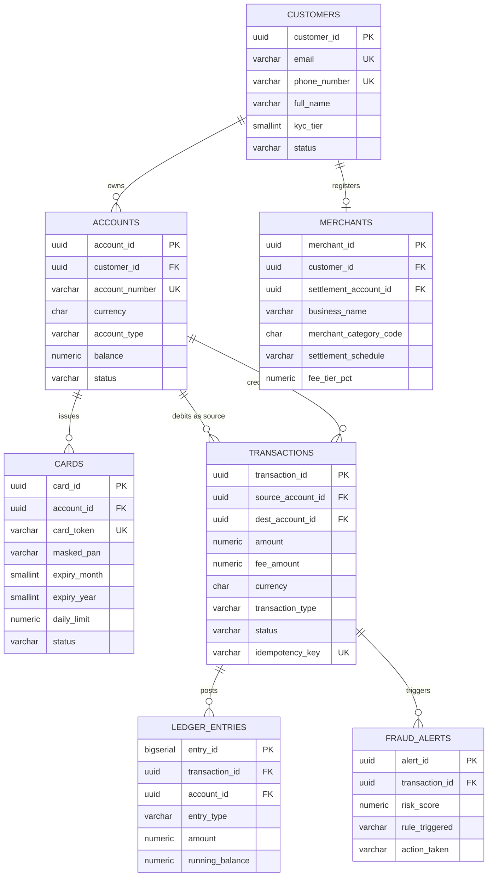

# Entity Relationship Diagram & Cardinalities Specification

## 1. Notation & Cardinality Conventions
The schema uses standard Crow's Foot ER notation:
- `||──────||`: One and only one (Mandatory 1:1)
- `||──────<|`: One to many (Mandatory 1:N)
- `|o──────<|`: Zero or many (Optional 1:N)

---

## 2. Entity Relationship Diagram

The diagram below renders natively on GitHub. Crow's foot symbols are read as: `||` exactly one, `o{` zero or many, `o|` zero or one.

`PK` marks the primary key, `FK` a foreign key and `UK` a unique constraint. Column types are abbreviated to a single token for the diagram; the authoritative definitions are in `01_schema_ddl.sql`.

> [!NOTE]
> Two distinct relationships run between `ACCOUNTS` and `TRANSACTIONS`, because every transfer touches one account as the source and another as the destination. Both are implemented as separate foreign keys (`source_account_id` and `dest_account_id`) rather than a single self-referencing edge.

---

## 3. Relationship Cardinality Dictionary

### customers (1) to accounts (N)
- **Cardinality:** 1 customer owns 1..N accounts.
- **Foreign Key:** `accounts.customer_id REFERENCES customers(customer_id)`
- **Integrity Rule:** `ON DELETE RESTRICT`. A customer record cannot be purged if active accounts exist.

### accounts (1) to transactions (N) [Source Origin]
- **Cardinality:** 1 account initiates 0..N debit transactions.
- **Foreign Key:** `transactions.source_account_id REFERENCES accounts(account_id)`
- **Integrity Rule:** `ON DELETE RESTRICT`. Historical transactions remain immutable.

### accounts (1) to transactions (N) [Beneficiary]
- **Cardinality:** 1 account receives 0..N credit transactions.
- **Foreign Key:** `transactions.dest_account_id REFERENCES accounts(account_id)`
- **Integrity Rule:** `ON DELETE RESTRICT`.

### transactions (1) to ledger_entries (N)
- **Cardinality:** 1 transaction spawns exactly 2..N balanced ledger entries.
- **Foreign Key:** `ledger_entries.transaction_id REFERENCES transactions(transaction_id)`
- **Integrity Rule:** `ON DELETE CASCADE`. If an uncommitted transaction is aborted, ledger entries follow lifecycle.

### customers (1) to merchants (0..1)
- **Cardinality:** 1 customer registers 0 or 1 commercial merchant entity.
- **Foreign Key:** `merchants.customer_id REFERENCES customers(customer_id) UNIQUE`
- **Integrity Rule:** `ON DELETE RESTRICT`.

### accounts (1) to cards (N)
- **Cardinality:** 1 account issues 0..N debit/virtual cards.
- **Foreign Key:** `cards.account_id REFERENCES accounts(account_id)`
- **Integrity Rule:** `ON DELETE CASCADE`. Closing an account revokes linked cards.

### transactions (1) to fraud_alerts (0..N)
- **Cardinality:** 1 transaction triggers 0..N risk evaluation alerts.
- **Foreign Key:** `fraud_alerts.transaction_id REFERENCES transactions(transaction_id)`
- **Integrity Rule:** `ON DELETE CASCADE`.
